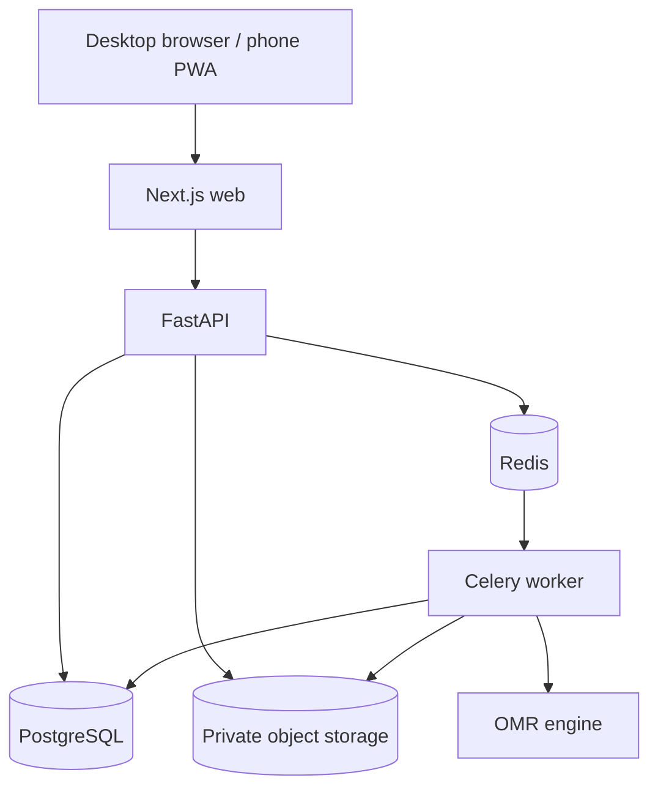

# System architecture

## Architecture style

Start with a **modular monolith plus an independently scalable processing worker**. Keep domain boundaries explicit without introducing networked microservices before scaling or team boundaries require them.

## Components

| Component | Responsibility |
| --- | --- |
| Next.js web app | Exam setup, template preview, scan intake, review, analytics |
| FastAPI API | Authorization, validation, domain operations, upload orchestration |
| PostgreSQL | Organization, exam, template, answer key, scan, detection, result, audit data |
| Object storage | Immutable original scans and derived artifacts |
| Redis | Queue and worker coordination |
| Celery worker | Page preprocessing, recognition, and export jobs |
| OMR engine | Image transforms, alignment, bubble measurement, classification |
| Template engine | Validated template model, coordinate mapping, PDF generation boundary |

## Deployment view

Use short-lived signed uploads for large files where supported. The API creates upload metadata and processing jobs only after validating ownership and file metadata.

## Domain boundaries
- Identity and tenancy: organizations, memberships, roles, authorization.
- Assessment: exams, sections, paper sets, questions, marking rules, answer-key versions.
- Template: immutable layout versions and generated print artifacts.
- Ingestion: batches, files, pages, validation, deduplication.
- Recognition: alignment, quality metrics, bubble measurements, response states, engine metadata.
- Evaluation: pure scoring from examiner-approved responses.
- Review: corrections, reviewer identity, timestamps, before/after values.
- Reporting: exports and analytics.

## Worker boundary

Do not run CPU-heavy processing inside HTTP request handlers. The API stores upload metadata and schedules an idempotent worker task. A worker loads the original object, resolves the exact template version, processes the page, persists detections, and updates job state.

## Storage and reliability

- Original upload: immutable object with checksum and content type.
- Normalized pages and overlays: derived artifacts with processing version and retention policy.
- Results: relational records with reproducible snapshots.
- Jobs: stable idempotency keys, bounded retries, safe diagnostics, correlation IDs.
- Reprocessing: a new processing attempt, never silent mutation of old evidence.

## Scaling

Scale worker concurrency independently from API instances. Add separate queues for recognition and report generation only when workload measurements justify them. Treat uploads as untrusted; bound PDF page count, image dimensions, memory, and processing time.
